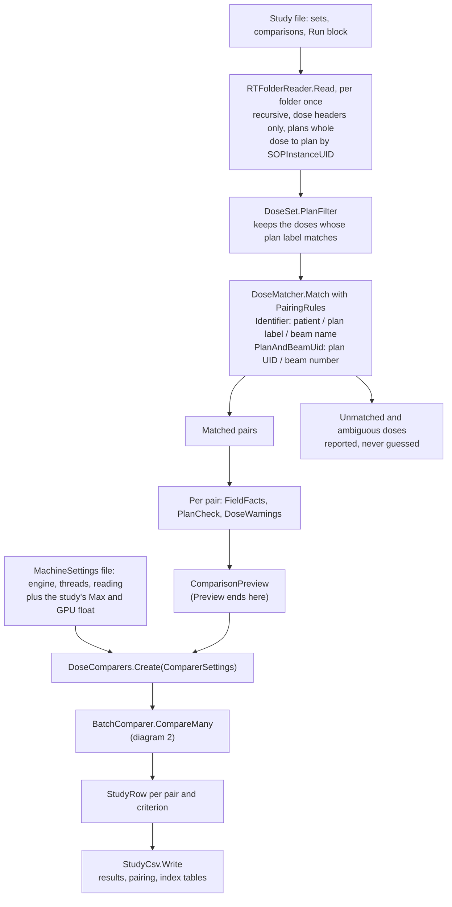
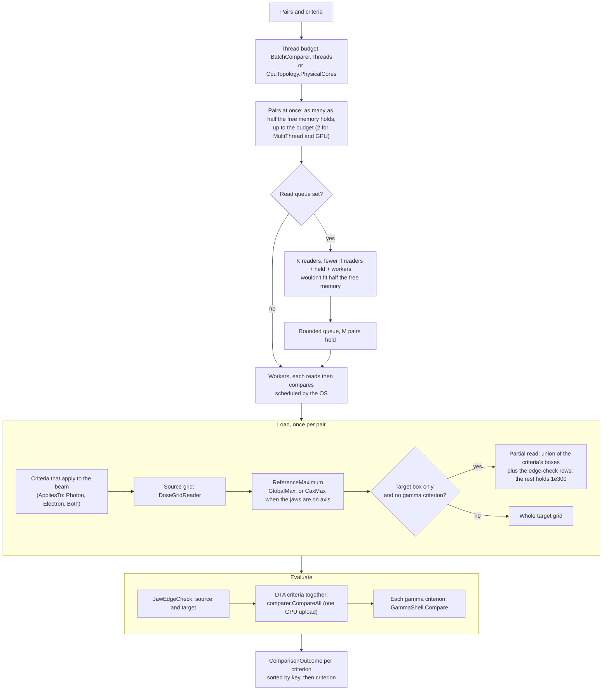
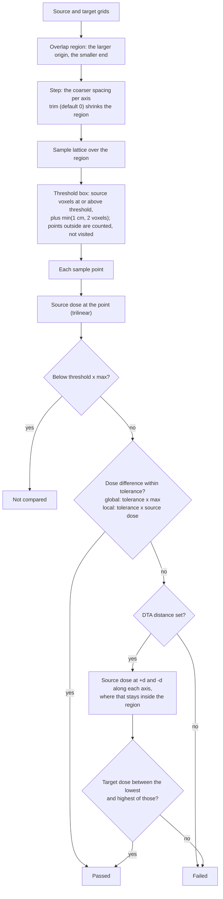
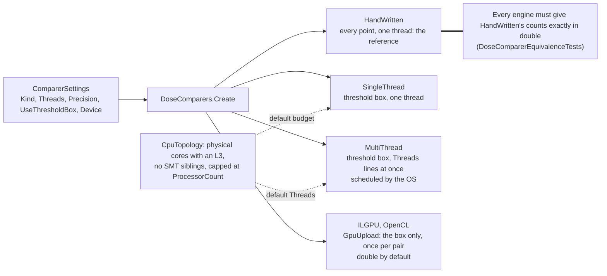

# Data flow

How doses move through a comparison, from folders to CSV rows. The diagrams are [Mermaid](https://mermaid.js.org),
which GitHub draws in place. **A change to any step shown here updates its diagram in the same commit** (AGENTS.md).

## 1. A study, end to end

`StudyRunner.Run` (prototypes/DSCprototypes.Shared/Studies). Preview stops after the pairing.

## 2. Inside `BatchComparer.CompareMany`

Each pair is read once for every criterion. With no read queue, each worker reads its own pair, then compares it.

## 3. One DTA comparison

`ComparisonSetup.For`, then `PointRules.Evaluate` at every sample point. These are `HandWrittenComparer`'s rules, in
the same order and in double, so every engine gives its counts exactly.

"Max" is the reference maximum from diagram 2. A point with no neighbour inside the region fails.

## 4. The engines

Float on the GPU engines is a user's choice and may differ from the reference on a few points in millions.
Core selection: [core-selection.md](core-selection.md).
